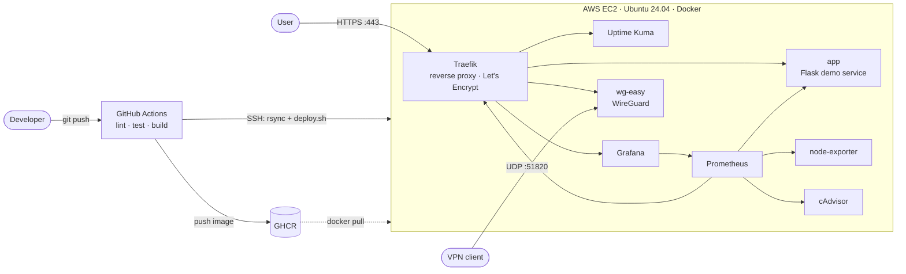

# homelab-devops


A production-style self-hosted platform on a single cloud server, built end to end:
**Terraform → hardened Ubuntu → Traefik with automatic TLS → WireGuard VPN → Dockerized services → Prometheus/Grafana monitoring → CI/CD with GitHub Actions**.

## Architecture



Only ports **22, 80, 443 and 51820/udp** are reachable from the internet. Prometheus, the exporters and all container ports
stay on internal Docker networks.

## Services

| URL | Service | Purpose | Auth |
|---|---|---|---|
| `app.<domain>` | Flask app | Demo service deployed by CI/CD | public |
| `status.<domain>` | Uptime Kuma | Uptime checks and status page | Kuma login |
| `grafana.<domain>` | Grafana | Dashboards (host, containers, app, Traefik) | Grafana login |
| `vpn.<domain>` | wg-easy | WireGuard clients and QR codes | wg-easy password |
| `traefik.<domain>` | Traefik dashboard | Routers, services, certificates | basic auth |
| — (internal) | Prometheus | Metrics + alert rules | not exposed |

## Repository layout

```
terraform/          EC2, security group, Elastic IP, cloud-init (IMDSv2, encrypted EBS)
scripts/
  bootstrap.sh      Server setup: Docker, deploy user, SSH hardening, UFW, fail2ban, swap
  deploy.sh         Zero-touch deploy with health check and automatic rollback
  backup.sh         Volume backups with retention
stack/
  docker-compose.yml
  prometheus/       Scrape config + alert rules
  grafana/          Provisioned datasource and dashboard
app/                Flask service with /health and Prometheus /metrics, Dockerfile, tests
.github/workflows/  CI/CD pipeline
docs/RUNBOOK.md     How to debug common failures
```

## CI/CD pipeline

```
push / PR ─► lint (ShellCheck, yamllint, Hadolint, compose config)
          ─► terraform fmt + validate
          ─► pytest
                └─► build image (push to GHCR on main only)
                        └─► deploy (main only): rsync stack → deploy.sh → smoke test
```

- Image tags are immutable (`sha-<commit>`), so every deploy is traceable and easy to roll back.
- `deploy.sh` waits for the container health check and **rolls back to the previous image** if it fails.
- The SSH host key is pinned in `SSH_KNOWN_HOSTS`. No `StrictHostKeyChecking=no`.
- The registry token is only valid for the job and is logged out after deploy.

## Security decisions

- **SSH:** key-only, root login disabled, fail2ban, separate CI key.
- **Firewall in two layers:** AWS security group plus UFW. Docker-published ports bypass UFW, so only the ports that
  must be public are published at all.
- **Instance:** IMDSv2 required, encrypted EBS, automatic security updates, T3 credits set to `standard` (no surprise bills).
- **Containers:** the app runs as non-root with a read-only filesystem and `no-new-privileges`; log rotation everywhere.
- **TLS:** automatic Let's Encrypt certificates, HTTP→HTTPS redirect, HSTS and security headers.
- **Secrets** are never committed: `.env`, `htpasswd` and Terraform state are git-ignored.
- `/metrics` is blocked at the proxy, so only Prometheus can read it, over the internal network.

## Quick start

Requirements: an AWS account, Terraform ≥ 1.6, an SSH key, and a domain (or a free `sslip.io` name).

```bash
# 1. Infrastructure
cd terraform
cp terraform.tfvars.example terraform.tfvars
terraform init && terraform apply
# outputs: public_ip, ssh_command, sslip_domain

# 2. DNS: point A records for app/status/grafana/vpn/traefik.<domain> to public_ip
#    (or use <ip-with-dashes>.sslip.io as DOMAIN and skip this step)

# 3. One-time secrets on the server (they never go through git or CI)
scp stack/.env.example deploy@<public_ip>:/opt/homelab/.env
ssh deploy@<public_ip>
cd /opt/homelab && nano .env
docker run --rm ghcr.io/wg-easy/wg-easy:14 wgpw 'vpn-ui-password'   # -> WG_PASSWORD_HASH
mkdir -p traefik && htpasswd -nbB admin 'strong-password' > traefik/users.htpasswd

# 4. Deploy: set the GitHub secrets/variables below and push to main.
#    CI syncs stack/ to /opt/homelab and runs scripts/deploy.sh.
```

GitHub configuration for automatic deploys:

| Type | Name | Value |
|---|---|---|
| Secret | `SSH_HOST` | server IP |
| Secret | `SSH_USER` | `deploy` |
| Secret | `SSH_PRIVATE_KEY` | private key of a dedicated CI key pair |
| Secret | `SSH_KNOWN_HOSTS` | output of `ssh-keyscan -t ed25519 <ip>` |
| Variable | `DEPLOY_ENABLED` | `true` |
| Variable | `APP_URL` | `https://app.<domain>` (smoke test) |

## Operations

```bash
docker compose ps                     # status and health of every service
docker compose logs -f --tail=100 app # follow logs
sudo bash scripts/backup.sh           # back up volumes and .env
terraform destroy                     # tear everything down (stops all costs)
```

Troubleshooting guide: [docs/RUNBOOK.md](docs/RUNBOOK.md).

## Incident log

Real problems I hit while building and running this, and how I fixed them.

| # | Symptom | Root cause | How I found it | Fix |
|---|---|---|---|---|
| 1 | | | | |

## Roadmap

- [ ] Admin UIs (Grafana, Traefik, wg-easy) reachable only through the VPN
- [ ] Alertmanager → Telegram notifications
- [ ] Remote Terraform state in S3 with locking
- [ ] Off-site backups to S3 + a tested restore procedure
- [ ] Centralized logs with Loki
- [ ] Docker socket proxy for Traefik
- [ ] Deploy over AWS SSM instead of public SSH
